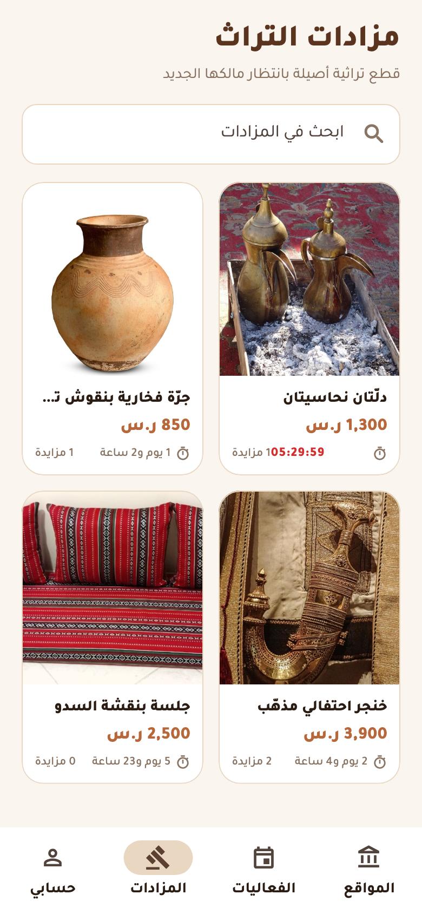
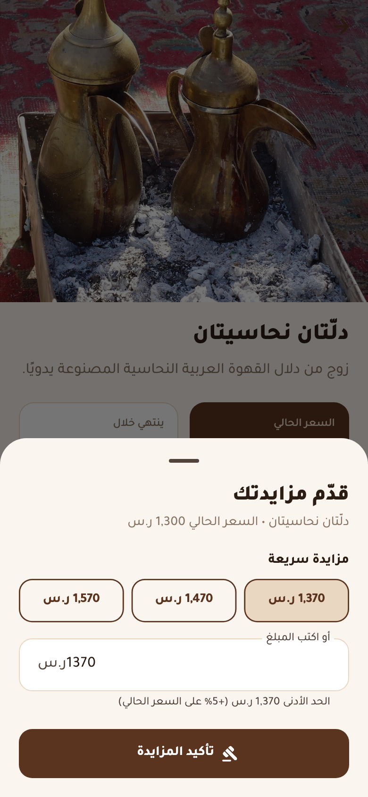
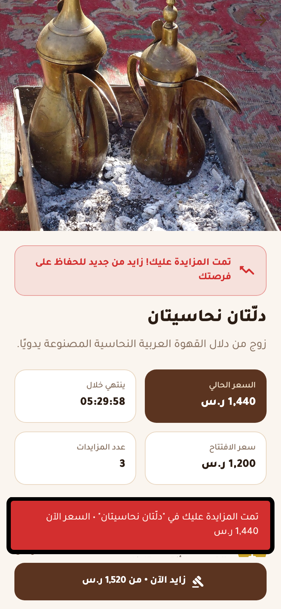
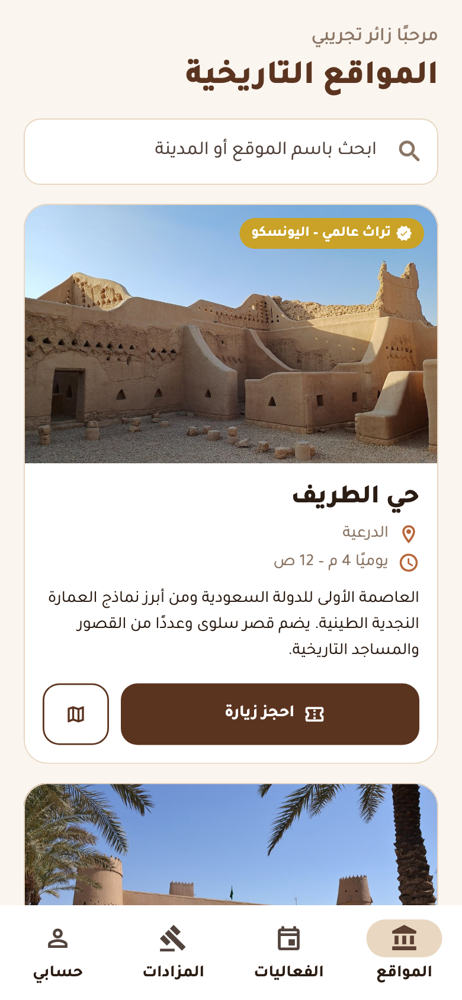
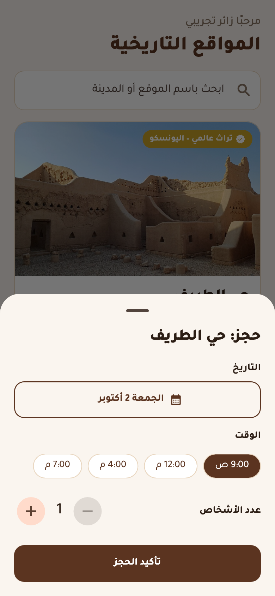
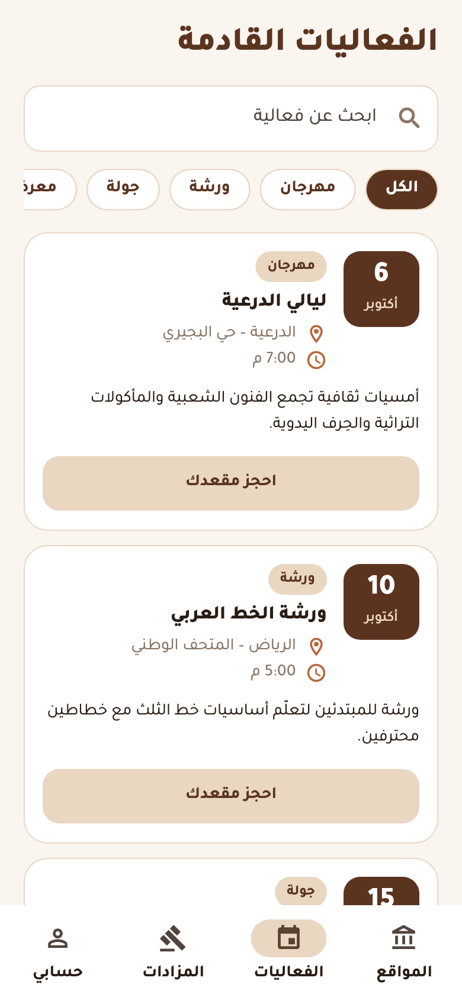
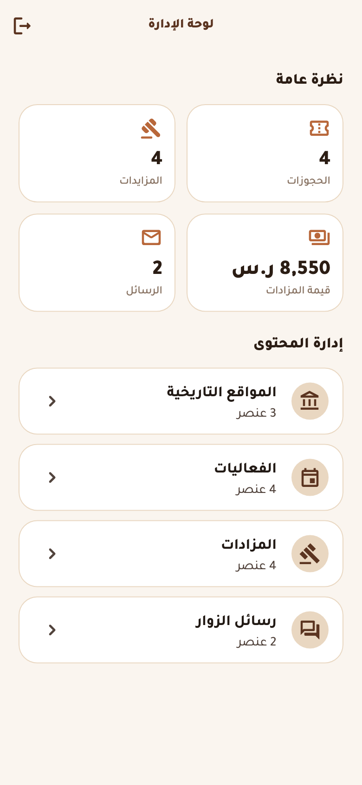

<div align="center">


# Saudi Heritage

**Bid on heritage collectibles, explore Saudi heritage sites, and book cultural events.**

تطبيق لاستكشاف المواقع التراثية في المملكة، وحجز الفعاليات الثقافية، والمزايدة على القطع التراثية.


[](https://github.com/MuniraAlzughaibi/saudi-heritage/actions/workflows/ci.yml)

</div>

---

## Screenshots

<p align="center">
  
  
  
  
</p>
<p align="center">
  
  
  
  
</p>

## Features

### 🔨 Heritage auctions (core feature)
- **Live auctions** for heritage collectibles with current price, bid count and a **live countdown** that switches to a ticking `HH:MM:SS` clock in the final day.
- **Bid sheet** with one-tap quick bids plus a custom amount.
- **Bidding rules enforced in the data layer:** every bid must beat the current price by at least **5%**, closed auctions reject bids, and the current leader can't outbid themselves.
- **Leading / outbid status** on every auction card and detail page, plus an **instant in-app alert** when someone outbids you.
- **My bids** screen tracking every auction you've joined and whether you're still winning.
- **Full bid history** per item, with the leading bidder highlighted.
- **Demo rival bidder:** in demo mode a simulated competitor answers your bids after a few seconds, so the whole flow (lead → outbid → bid again → win) can be tried solo.

### 🏛️ Heritage sites & 📅 events
- Sites with photos, city, opening hours, UNESCO badge and a map link. Book a visit by date, time slot and group size.
- Upcoming events filtered by category (festival, workshop, tour, exhibition) with seat booking.
- **My bookings** to review and cancel reservations.

### 🛠️ Admin panel
- Dashboard: bookings, bids, total auction value and visitor messages.
- Create / edit / delete heritage sites, events and auction items, and drill into any auction's bid history.
- Inbox for messages sent from the contact form.

## Try it

The app runs entirely on **demo data**: no backend or setup is needed. The login screen has one-tap demo accounts:

| Role | Email | Password |
|---|---|---|
| Visitor | `visitor@heritage.demo` | `demo1234` |
| Admin | `admin@heritage.demo` | `demo1234` |

```bash
flutter pub get
flutter run            # Android / iOS
flutter run -d chrome  # Web
```

## Architecture

```
lib/
├── core/        theme, formatters, AppScope (dependency injection)
├── data/        models, HeritageRepository & AuthService interfaces + demo implementations
├── widgets/     shared UI (booking sheet, empty states, pills...)
└── screens/
    ├── auth/        welcome, login, sign-up, onboarding survey
    ├── home/        bottom-navigation shell
    ├── places/  events/  auctions/  bookings/  account/
    └── admin/       dashboard + management screens
```

- **Backend-agnostic data layer:** every screen talks to the abstract `HeritageRepository` and `AuthService`. The demo implementations keep data in memory; a Firebase or REST implementation can be dropped in from `main.dart` without touching the UI.
- **State management:** `ChangeNotifier` services exposed through an `InheritedNotifier` (`AppScope`), and a broadcast `Stream` for outbid alerts. No external state packages needed.
- **Arabic-first UI:** full RTL layout, Arabic localization for date pickers, and the bundled Tajawal font.
- **Tests:** unit tests for bidding rules, outbid alerts, the rival-bidder simulation (with `fake_async`), bookings and authentication, plus a widget test (`flutter test`).
- **CI/CD with GitHub Actions:** every push and pull request runs formatting checks, `flutter analyze` and the test suite; pushes to `main` then build the web app and deploy it to GitHub Pages automatically ([workflow](.github/workflows/ci.yml)).
- **Reproducible screenshots:** `flutter test tool/screenshots_test.dart` drives the real app and regenerates every image above.

## Team

Originally built as a university team project with Firebase by:

- **Munira Alzughaibi** ([@MuniraAlzughaibi](https://github.com/MuniraAlzughaibi))
- **Layla**
- **Sadeem**
- **Sarah**

Later refactored by Munira into a cleaner, testable architecture with a refreshed UI and a self-contained demo mode.

## Credits

- Font: [Tajawal](https://fonts.google.com/specimen/Tajawal) (SIL Open Font License)
- Photos from [Wikimedia Commons](https://commons.wikimedia.org), resized for the app and used under their respective licenses:

| Photo | Author | License |
|---|---|---|
| Masmak Fortress | Sammy Six | [CC BY 2.0](https://commons.wikimedia.org/wiki/File:Masmak_Fortress_(6329473680).jpg) |
| At-Turaif District | Radosław Botev | [CC BY 3.0 pl](https://commons.wikimedia.org/wiki/File:At-Turaif_District_in_ad-Dir%27iyah_(6).jpg) |
| Hegra (Mada'in Salih) | Following Hadrian | [CC BY-SA 2.0](https://commons.wikimedia.org/wiki/File:27,_Hegra_(Mada%27in_Salih),_Saudi_Arabia.jpg) |
| Khanjar dagger | Mary Harrsch from Springfield, Oregon, USA | [CC BY 2.0](https://commons.wikimedia.org/wiki/File:The_khanjar_ceremonial_dagger_presented_to_T._E._Lawrence_aka_Lawrence_of_Arabia_early_20th_century_CE_(27969300341).jpg) |
| Dallah coffee pots | Elph | [Public domain](https://commons.wikimedia.org/wiki/File:Dalleh.JPG) |
| Pottery jar (National Museum) | Saudi Press Agency (SPA) | [CC BY-SA 4.0](https://commons.wikimedia.org/wiki/File:Jar_Dating_to_the_Second_Millennium_BC,_Found_in_Tabuk_Region,_on_Display_at_the_National_Museum_(2025).jpg) |
| Sadu-style majlis | Ashley Columbus | [CC0](https://commons.wikimedia.org/wiki/File:Majlis_in_Sadu_style.jpg) |
